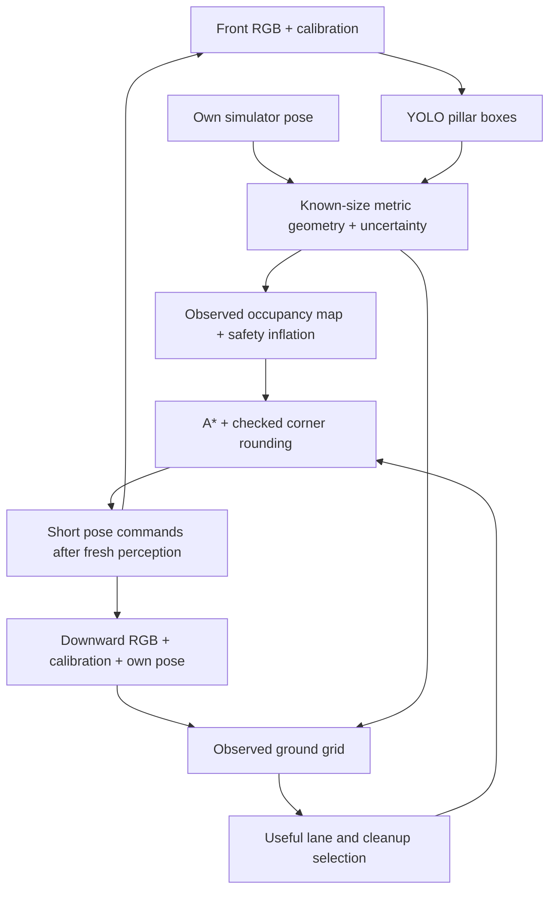

# Tello + Go2 EDU: RGB perception and adaptive coverage

A ROS 2 Humble / Gazebo Harmonic workspace for developing a Tello search mission
and a later handoff to a Unitree Go2 EDU.

The current working prototype flies a **simulated Tello using RGB images**, maps
one known obstacle with YOLO and metric geometry, and uses A* to bypass it.
Coverage follows the ground actually observed by the downward camera, so the
drone can continue into another lane instead of repeating a rigid zigzag.

**Scope:** this is a controlled, kinematic simulation. Localization uses the
simulator's drone pose. It does not validate physical autonomous flight,
general obstacle avoidance, or a Go2 walking controller.

## Current capabilities

| Feature | Status |
| --- | --- |
| Front and downward RGB video | Implemented, with a live camera and flight dashboard |
| Obstacle detection and ranging | YOLOv8n trained for one static orange/black pillar of known dimensions |
| Obstacle avoidance | Incremental occupancy map, inflated safety margin, A* and checked corner rounding |
| Adaptive coverage | Observed ground grid, flexible lane selection and cleanup of missed patches |
| ROI selection | Circle, star, reproducible irregular polygon, or a polygon drawn in the browser |
| Small search target | One blue box spawned randomly inside the selected ROI on each launch |
| Blue-target identification and estimated position | Planned; the box is currently spawn-only |
| Camera localization and physical Tello SDK flight | Not implemented or validated |
| Target handoff to Go2 EDU | Planned; no target message or autonomous ground mission yet |

## Quick start — prepared workspace

Run from the repository root in a terminal on your graphical desktop:

```bash
./scripts/zigzag.sh --shape circle --radius 3
```

**Fresh clone?** Complete [first-time setup](#first-time-setup) first. Model
weights and validation profiles are generated locally and are not included in Git.

The launcher starts the existing container, generates the RGB-only world,
opens Gazebo, and runs the mission with a map and both camera views. The drone:

1. Takes off from the selected home position.
2. Enters at the nearest point on the ROI perimeter and completes the loop.
3. Selects useful sweep segments from the remaining unobserved ground.
4. Bypasses the pillar and can continue into later lanes.
5. Returns for any remaining observable patches, then returns home and lands.

The default world contains:

- An orange/black pillar, **0.8 m in diameter and 1.8 m high**. These dimensions
  are an explicit ranging prior; its position is not supplied to navigation.
- A blue box, **20 × 20 × 15 cm**, on the floor at a fresh random location. Its
  full footprint stays inside the ROI, clear of the pillar and takeoff point.
  Its fixture position is not an estimated detection and is not sent to the Go2.

The launcher reuses the installed Docker environment; it does not rebuild or
pull images. Scripts and models are bind-mounted at `/workspace`.

`Ctrl+C` ends the session. Closing the map waits for the current mission to
finish, then closes that session's Gazebo process. After landing, the map and
cameras remain open until you close them.

## First-time setup

### 1. Prepare the host and container

The supported workflow uses a Linux graphical desktop with Docker Engine,
Docker Compose v2, `xauth`, and access to the host's `/dev/dri` devices.
The Docker image provides Ubuntu 22.04, ROS 2 Humble, Gazebo Harmonic, Qt and
Matplotlib. Neural-network packages are installed separately in step 3.

```bash
git clone https://github.com/Joaoanbp/ros2-uav-uvg-tello-go2.git
cd ros2-uav-uvg-tello-go2
cp docker/.env.example docker/.env
id -u
id -g
getent group video render
```

Edit `docker/.env` so `USER_UID`, `USER_GID`, `VIDEO_GID`, `RENDER_GID` and
`DISPLAY` match your host. Keep this machine-specific file local.

```bash
docker compose -f docker/compose.yaml up -d --build robotics
```

The ROI launcher copies the current display's X11/XWayland authorization using
`xauth` and removes the temporary cookie on exit. Run it from the desktop
session with valid `DISPLAY` and `XAUTHORITY` values.

### 2. Restore the pinned simulator dependencies

Open a container shell:

```bash
docker compose -f docker/compose.yaml exec robotics bash
```

Inside that shell:

```bash
cd /workspace
vcs import . < dependencies.repos
git -C code/ardupilot submodule update --init --recursive
cmake -S code/ardupilot_gazebo -B code/ardupilot_gazebo/build \
  -DCMAKE_BUILD_TYPE=RelWithDebInfo
cmake --build code/ardupilot_gazebo/build --parallel
```

[`dependencies.repos`](dependencies.repos) pins ArduPilot, its Gazebo plugin,
and the Unitree Python SDK. Their source trees live in the ignored `code/`
directory. Importing the Unitree SDK does not establish a physical robot connection.

### 3. Prepare and validate the RGB detector

Continue inside the container:

```bash
python3 -m pip install --user numpy==1.26.4 opencv-python==4.10.0.84 scipy==1.13.1
python3 -m pip install --user torch==2.2.2 torchvision==0.17.2 \
  --index-url https://download.pytorch.org/whl/cpu
python3 -m pip install --user ultralytics==8.3.40
mkdir -p /workspace/models
curl -fL -o /workspace/models/yolov8n.pt \
  https://github.com/ultralytics/assets/releases/download/v8.3.0/yolov8n.pt
PYTHONPATH=/workspace/scripts python3 /workspace/scripts/prepare_yolo_pillar.py \
  --capture --train --validate
exit
```

This captures independent training/validation/test RGB views, fine-tunes the
small pillar detector, and checks its metric position estimates. Offline
fixture geometry supplies training labels and scoring only. The training
fixture does not contain the new blue search target.

The process creates:

| Path | Purpose |
| --- | --- |
| `models/yolo_pillar.pt` | Trained pillar detector |
| `models/yolo_pillar.json` | Validation approval, dimensions and checkpoint hash |
| `artifacts/yolo-pillar/` | Dataset, training outputs and held-out validation report |

Navigation checks that the profile matches the weights and permits translation
only when validation approves the source. If validation fails, review the report
before running a mission. There is no automatic fallback to Gazebo depth.

The perception packages are installed in the container user's Python environment;
repeat that installation if you recreate the container. The workspace-mounted
weights and datasets survive container recreation.

## Mission commands

### Choose an ROI

```bash
./scripts/zigzag.sh --shape circle --radius 3
./scripts/zigzag.sh --shape star --radius 4
./scripts/zigzag.sh --shape random --radius 4 --seed 123
```

`--seed` reproduces the irregular polygon. The blue target is randomized
independently on every launch.

For a hand-drawn ROI:

```bash
./scripts/zigzag-desenhado.sh
```

The local editor opens at `http://127.0.0.1:8765/`. Mark vertices in perimeter
order, close the polygon, choose the takeoff point, and click **Iniciar no
Gazebo**. The mission is saved to `artifacts/zigzag-desenhado.json`.
Self-intersecting and degenerate polygons are rejected. The preview, export and
executor share the same nearest-entry plan.

For a phone on the same trusted network, use
`./scripts/zigzag-desenhado.sh --host 0.0.0.0` and open the computer's IP on port
8765. Coordinates are local simulation meters, not GPS.

### Common options

| Option | Default | Meaning |
| --- | --- | --- |
| `--radius` | `4` | Circle/external radius in meters; maximum radius for an irregular ROI |
| `--center-x`, `--center-y` | `0`, `0` | ROI center in world coordinates |
| `--start-x`, `--start-y` | `-7`, `-5` | Takeoff and landing point |
| `--altitude` | `1.6` | Cruise altitude in meters |
| `--footprint-width` | `2` | Requested ground-footprint diameter; observed coverage is also limited by camera calibration |
| `--side-overlap` | `80` | Percentage used to space the nominal guide lanes |
| `--coverage-mode` | `adaptive` | Select useful observed-coverage passes; `fixed` follows nominal lanes |
| `--depth-source` | `yolo` | RGB pillar geometry; `gazebo` selects the legacy synthetic-depth baseline |
| `--evaluation-dir` | Unset | Save RGB observations, timing, coverage, decisions and stops |
| `--no-camera` | Unset | Hide camera panels; perception stays active |
| `--map-rotation` | `90` | Clockwise display rotation only; mission coordinates remain unchanged |

Example with recording:

```bash
./scripts/zigzag.sh --shape circle --radius 3 \
  --start-x -7 --start-y -5 --altitude 1.6 \
  --evaluation-dir /workspace/artifacts/my-flight
```

The launcher writes `artifacts/zigzag-SHAPE-voo.png` and
`artifacts/zigzag-SHAPE-gazebo.log`. Separate evaluation directories preserve
individual runs; reusing one overwrites its event log.

### Preview or export without Gazebo

These planning commands use the Python standard library:

```bash
python3 scripts/zigzag_roi.py --shape circle --radius 3 \
  --preview artifacts/circle.svg
python3 scripts/zigzag_roi.py --shape random --seed 123 --dry-run \
  --plan-json artifacts/random-plan.json
```

SVGs and JSON contain the nominal guide plan. Sensor observations determine the
actual adaptive trajectory during execution. Use `--dry-run` or `--preview`
when exporting without flying; `--plan-json` alone does not disable execution.

## How perception and coverage work



### Obstacle distance and movement

YOLO boxes alone do not provide metric distance. The ranging code fits the
projection of the known upright cylinder to the detected box using calibrated
optics, a flat floor and the drone pose. Its conservative occupied footprint
includes position uncertainty. The map begins empty and receives no simulator
obstacle poses, names or scene geometry.

The planner uses a 20 cm grid with a nominal 50 cm safety margin plus grid
allowance. Translation is limited to 18 cm steps, with a fresh synchronized
front observation before each step. Stale, invalid or inconsistent inputs stop
the drone. The first static obstacle envelope is retained through matching
partial views. Rounded corners are used only when every resulting segment
passes collision checks; tight corners are retained when necessary.

The default launcher generates `artifacts/tello-yolo-rgb.sdf` with **ordinary
RGB cameras only**. It has no depth sensor. Navigation and recording do not
subscribe to synthetic depth in this mode; an old RGB-D world is refused.

### Flexible coverage

The nominal zigzag is a set of guides. A 20 cm ground grid records cells whose
four corners were inside a recent, calibrated downward RGB view and the
requested footprint. Predicted future footprints help select a route, but do
not count as observations. Ground hidden by the pillar stays pending.

A bypass may therefore lead from lane 10 to lane 12. Any part of lane 11 that
was not observed remains a cleanup task. Adaptive sweep connections stay inside
the ROI; approach and return can be outside it. The obstacle envelope, including
its uncertainty, is reported separately as excluded and never counted as
observed ground. Completion requires no remaining required cells; inaccessible
coverage is reported as incomplete.

The live map shows observed ground in green, pending ground in yellow, the
excluded envelope in gray, obstacle occupancy in red, and the local route in
purple.

**Adaptive mode does not enforce the nominal overlap on every flown pass.**
For repeated nominal lanes, select:

```bash
./scripts/zigzag.sh --shape circle --radius 3 --coverage-mode fixed
```

## Tests and recorded results

Run the regression suite in the prepared container:

```bash
docker compose -f docker/compose.yaml exec -T \
  -e PYTHONPATH=/workspace/scripts -e MPLCONFIGDIR=/tmp/tello-tests \
  robotics python3 -B -m unittest discover -s /workspace/tests -p 'test_*.py'
```

On a host with NumPy and SciPy, most tests also run without a Gazebo server:

```bash
PYTHONPATH=scripts MPLCONFIGDIR=/tmp/tello-tests \
  python3 -B -m unittest discover -s tests -p 'test_*.py'
```

The RGB-only integration checks create their own worlds and transport partitions:

```bash
docker compose -f docker/compose.yaml exec -T -e PYTHONPATH=/workspace/scripts \
  robotics python3 /workspace/tests/check_yolo_navigation_gazebo.py
docker compose -f docker/compose.yaml exec -T -e PYTHONPATH=/workspace/scripts \
  robotics python3 /workspace/tests/check_yolo_navigation_gazebo.py --adaptive
```

They check sensor subscriptions, map initialization, obstacle clearance,
coverage where enabled, return, landing and rejection of missing camera data.
Results are generated locally under `artifacts/yolo-navigation/` and
`artifacts/yolo-adaptive/`.

A recorded controlled pillar benchmark used the same 3 m circular ROI and home
position for both modes, before the blue target was added:

| Metric | Fixed lanes | Adaptive coverage |
| --- | ---: | ---: |
| Sweep passes | 15 | 8 |
| Detours | 10 | 3 |
| Commanded horizontal travel, including perimeter and approach/return | 128.17 m | 48.31 m |

The adaptive run observed all 560 required cells, reported 156 uncertain-envelope
cells separately, returned home and landed. These are results from one
controlled kinematic scenario, not a general performance or battery-life claim.
The detailed [RGB navigation guide](docs/yolo-rgb-navigation.md) records the
validation and acceptance results. Generated recordings, plots and checkpoints
are not versioned.

## Other simulation modes

| Mode | Command / entry point | Purpose |
| --- | --- | --- |
| Synthetic-depth baseline | `./scripts/zigzag.sh --shape circle --depth-source gazebo` | Legacy tree world and Gazebo RGB-D comparison |
| Dense RGB-depth experiment | `--depth-source rgb` | Depth Anything V2 experiment; failed validation and remains blocked from authorizing translation |
| Combined Tello / Go2 world | `./scripts/run_simulation.sh --headless` | Server for simulator integration experiments |
| Combined-world checks | `./scripts/check_simulation.sh` | Check both robot models and ArduPilot UDP port 9002 |
| Kinematic smoke mission | `./scripts/missao_de_teste.sh` | Pause physics, raise Tello to 5 m and move Go2 2 m |
| Go2 pose demonstration | `scripts/go2_avancar.py --distance 5` inside the container | Move the simulated Go2; does not command a walking controller |

The combined world keeps a dynamic Tello approximation and an ArduPilot Gazebo
plugin using UDP 9002. The model is an integration approximation, not an
identified Tello airframe. ArduPilot SITL requires its own prepared dependencies
and tuning; the ROI coverage missions use direct pose commands instead.

For example, with the combined world running:

```bash
docker compose -f docker/compose.yaml exec robotics \
  python3 /workspace/scripts/go2_avancar.py --distance 5
```

## Limits and next stages

- Obstacle perception is validated for one known, static pillar on a flat floor.
  Unknown objects, wires, vegetation, transparency and moving obstacles require
  additional perception and validation. Missing a detection does not certify free space.
- The blue box is a scene target only. Its random spawn coordinates are simulator
  ground truth, not a visual position estimate. Target detection is a separate next step.
- Coverage measures geometric camera visibility at the grid resolution. It does
  not certify recognition of a search target in every image or at every location.
- Localization still uses the simulator pose. Physical Tello video, telemetry,
  camera calibration and localization must be validated together before autonomous tests.
- Home, takeoff and descent must be clear. The kinematic simulator does not test
  real flight dynamics, collision response or emergency landing behavior.
- A future Go2 handoff needs a target position in a named shared frame, its
  uncertainty and supporting image/video evidence. The Go2 must localize and plan
  its own ground route. This connection is not implemented yet.

## Troubleshooting

| Symptom | Check |
| --- | --- |
| Missing checkpoint/profile | Complete detector preparation; the repository does not ship `models/` |
| Drone holds position | Read the reported stop reason: RGB/pose freshness, image quality, ranging consistency or validation approval |
| RGB-D world refused | Use the ROI launcher for the RGB-only world; select `--depth-source gazebo` explicitly for the baseline |
| Missing display or Qt authorization | Run in the desktop session and check host `xauth`, `DISPLAY` and `XAUTHORITY`; rebuild the image if Qt packages are missing |
| ROI too small for the blue box | Use an ROI with enough interior space clear of the pillar and takeoff point |
| GUI packages conflict with pip packages | Use the launcher, which isolates the Ubuntu Qt stack from the inference worker's Python packages |
| Docker image/build error | Prepare the image with `docker compose -f docker/compose.yaml up -d --build robotics`; the mission launcher only reuses an existing local image |

## Repository map and further reading

| Path | Contents |
| --- | --- |
| `scripts/roi_plan.py`, `scripts/coverage_plan.py` | Shared ROI, entry and nominal coverage planning |
| `scripts/adaptive_coverage.py` | Ground-visibility grid and useful sweep selection |
| `scripts/yolo_geometry.py`, `scripts/depth_navigation.py` | RGB ranging, mapping and receding-horizon navigation |
| `scripts/yolo_fixture.py`, `scripts/prepare_yolo_pillar.py` | RGB-only world, random target and offline detector preparation |
| `scripts/drone_trajetoria.py`, `scripts/drone_camera.py` | Live dashboard and RGB streams |
| `scripts/zigzag.sh`, `scripts/zigzag-desenhado.sh` | Desktop mission launchers |
| `simulation/`, `docker/`, `tests/`, `web/` | Robot/world models, container, verification and ROI editor |
| `artifacts/`, `models/`, `code/`, `third_party/` | Local generated outputs and dependencies; ignored by Git |

Supporting documentation, primarily in Portuguese:

- [RGB-only YOLO navigation, training and coverage](docs/yolo-rgb-navigation.md)
- [Dense RGB-depth experiment and its limits](docs/rgb-depth-experiment.md)
- [Perception evaluation methods and results](docs/perception-evaluation.md)
- [Legacy synthetic-depth mapping and avoidance](OBJECT_DETECTION_AND_OBSTACLE_AVOIDANCE.md)
- [Coverage references](docs/boustrophedon.md)
- [Obstacle-detection literature review](artigos-papers/deteccao_obstaculos.md)
- [Mission conventions](AGENTS.md)
